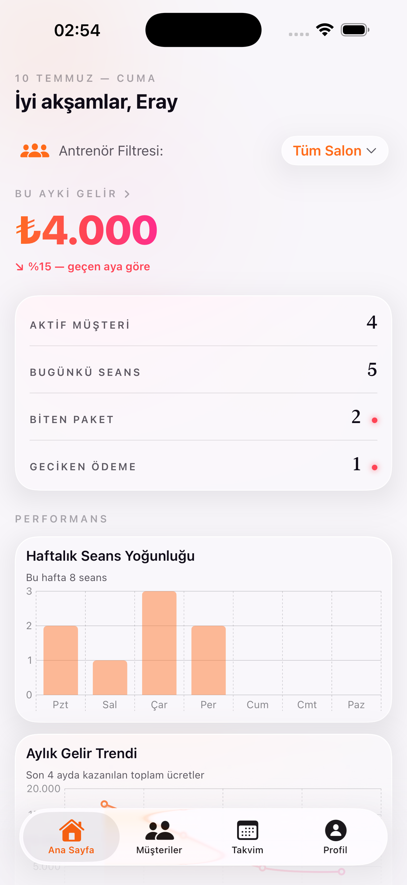
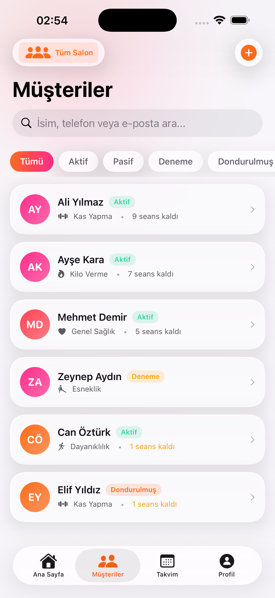
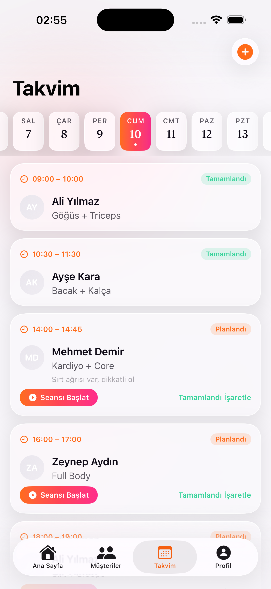
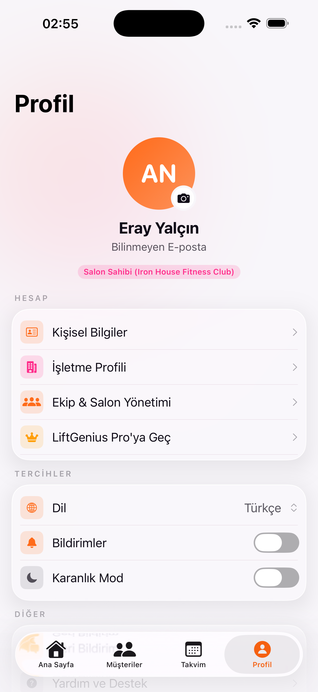

  
  
  
  

<em>Clients, packages, sessions, AI plans and cash flow for personal trainers and studios. 
This repository is the public showcase; the source code is kept private.</em>

<table>
  <tr>
    <td width="33%"></td>
    <td width="33%"></td>
    <td width="33%"></td>
  </tr>
  <tr>
    <td width="33%"></td>
    <td width="33%"></td>
    <td width="33%"></td>
  </tr>
</table>

## What it is

LiftGenius is a mobile CRM for personal trainers and gym owners, designed in a dark-first *Obsidian Glass* language. It runs the whole business from one place: clients and packages, sessions with live timers, AI-generated workout and nutrition plans, and a clear view of what has been paid and what is still owed. Owners can run a multi-trainer salon from the same app.

Everything is bilingual (TR / EN), syncs through Supabase and keeps an on-device cache so the app stays fast between fetches.

## Highlights

| | |
|---|---|
| **Live dashboard** | Revenue, active clients, today's sessions, expiring packages and overdue payments. |
| **Client CRM** | Goals, status, contact details, progress and personal records per client. |
| **Sessions** | A month calendar and a Dynamic Island / Live Activity session timer. |
| **AI plans** | Workout and nutrition plans tailored by Gemini, exportable as PDF. |
| **Finance** | Collected vs pending, payment methods and a six-month revenue chart. |
| **Reminders** | Pre-filled payment reminders via WhatsApp, SMS or a local notification. |
| **Widgets** | *Today's Sessions* and *Weekly Pulse* on the home screen. |
| **Team** | An owner role that manages several trainers and filters by trainer. |

## Two native apps, one backend

| | iOS | Android |
|---|---|---|
| **UI** | SwiftUI with a Liquid Glass design system | Jetpack Compose · Material 3 |
| **Architecture** | Services over Supabase with an on-device cache | MVVM, repositories, Hilt, Coroutines + Flow |
| **Live session** | Live Activity in the Dynamic Island and on the Lock Screen | Ongoing notification |
| **Widgets** | *Today's Sessions* · *Weekly Pulse* | Home-screen widget |
| **Sign-in** | Email, Google, Apple | Email, Google (Credential Manager) |
| **Reports** | A4 PDF templates through the share sheet | Canvas-drawn PDF export |
| **AI plans** | Gemini | Gemini |
| **Languages** | Turkish and English | Turkish and English |

Both apps share one Supabase project with row-level security, and the same models, so a trainer can switch devices without exporting anything. Deleting an account removes the user's own data on both platforms through one database function.

## The screens above

| Screen | Shows |
|---|---|
| Dashboard | Greeting, monthly revenue, active clients, today's sessions, expiring packages, overdue payments |
| Clients | The roster with status and package state |
| Client detail | Goals, measurements, progress and personal records |
| Calendar | The month grid and the day's sessions |
| Profile | The trainer, the salon and settings |
| Upgrade | What Pro adds |

## Türkçe özet

**LiftGenius**, kişisel antrenörler ve spor salonu sahipleri için koyu, cam efektli bir tasarımla hazırlanmış mobil CRM uygulaması. Müşteriler, paketler, seanslar, yapay zekâ ile antrenman ve beslenme planları ve nakit akışı tek ekranda. Bu depo uygulamanın vitrinidir: ekran görüntüleri ve özellikler burada, kaynak kod gizli tutuluyor.

 

Showcase only · native iOS (SwiftUI) and Android (Kotlin) apps on a shared Supabase backend · figures in the banner are examples.

