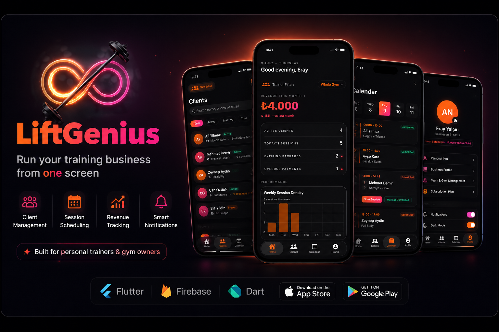
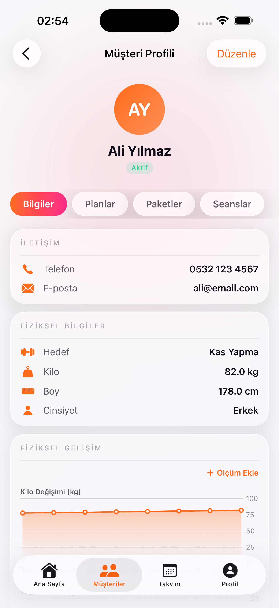
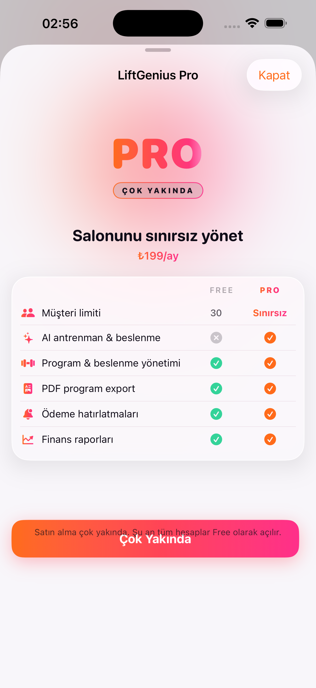

<div align="center">



<br /><br />


<br />


<br /><br />

```text
██╗     ██╗███████╗████████╗ ██████╗ ███████╗███╗   ██╗██╗██╗   ██╗███████╗
██║     ██║██╔════╝╚══██╔══╝██╔════╝ ██╔════╝████╗  ██║██║██║   ██║██╔════╝
██║     ██║█████╗     ██║   ██║  ███╗█████╗  ██╔██╗ ██║██║██║   ██║███████╗
██║     ██║██╔══╝     ██║   ██║   ██║██╔══╝  ██║╚██╗██║██║██║   ██║╚════██║
███████╗██║██║        ██║   ╚██████╔╝███████╗██║ ╚████║██║╚██████╔╝███████║
╚══════╝╚═╝╚═╝        ╚═╝    ╚═════╝ ╚══════╝╚═╝  ╚═══╝╚═╝ ╚═════╝ ╚══════╝
```

### **One screen. Your whole training business.**

### Clients, packages, sessions, AI plans and cash flow — for personal trainers and studios.

<br />

<sub>This repository is a public showcase for the mobile apps. Source code is kept private.</sub>

</div>

---

## ✦ What is LiftGenius?

**LiftGenius** is a mobile CRM for personal trainers and gym owners, built in a dark-first _Obsidian Glass_ design language. This showcase currently highlights the **iOS** experience, with **Android** documentation and visuals to be added here as they are ready for review. Run the whole business from one place: manage clients and their packages, schedule and complete sessions, generate **AI workout & nutrition plans** with Google Gemini, watch your real cash flow in a live finance dashboard, and never chase a payment again thanks to built-in reminders.

Everything is **bilingual (TR / EN)**, works with a **Supabase** backend for auth and sync, and keeps a durable **on-device cache** so the app stays fast and usable between fetches. Owners can run a multi-trainer salon with per-trainer filtering and team management.

Built with **Swift 5 · SwiftUI · Swift Charts · WidgetKit · ActivityKit (Live Activities)**, authenticated via **Supabase** (email, Google, Apple), with **PDF export** and **on-device local notifications**. Android assets will live in this same showcase structure once the Android readme is added.

> **Trainer-first by design.** No web app, no compromise — a native iOS experience with Dynamic Island session timers, home-screen widgets, haptics and serif-precise finance numbers.

---

## 📱 Screenshots

<div align="center">

### iOS







<br />

<sub>Dashboard · Clients · Detail · Calendar · Profile · Upgrade — live from the iPhone simulator.</sub>

<br /><br />

### Android

<div>
<sub>Android screenshots will be added here after the Android readme and assets are shared.</sub>
</div>

</div>

---

## ⚡ Features

| Feature                          | Description                                                                                                                                                              |
| -------------------------------- | ------------------------------------------------------------------------------------------------------------------------------------------------------------------------ |
| 🏠 **Live Dashboard**            | Time-aware greeting, monthly revenue hero (SF Display Heavy), active clients, today's sessions, expiring packages & overdue-payment alerts, weekly session-density chart |
| 👥 **Client CRM**                | Add / edit / delete clients, avatars, goals, status, phone/email, per-client detail with progress & personal records                                                     |
| 🎟️ **Packages**                  | Session packages with price, payment method, paid/pending state, remaining-session tracking and expiry                                                                   |
| 📅 **Calendar & Sessions**       | Month grid, add sessions, start a session (**Dynamic Island** live timer) and mark completed — package counts decrement automatically                                    |
| 🤖 **AI Plans (Gemini)**         | Generate tailored **workout** and **nutrition** plans from a client's profile with Google Gemini, then export them                                                       |
| 💸 **Finance & Analytics**       | Collected vs. pending ring, payment-method breakdown, 6-month revenue area chart, outstanding list — all animated, trainer-filter aware                                  |
| 🎯 **Goals & Streak**            | Apple-Activity-style dual rings (monthly revenue + sessions) with editable targets and a month-streak counter                                                            |
| 🔔 **Payment Reminders**         | Per-client reminder sheet → **WhatsApp / SMS / local notification** with a pre-filled, editable draft                                                                    |
| 📄 **PDF Export**                | Print-clean A4 **workout**, **nutrition** and **finance report** PDFs via the native share sheet                                                                         |
| 📈 **Progress & PRs**            | Log body metrics and personal records over time                                                                                                                          |
| 🧩 **Widgets & Live Activities** | Home-screen **Today's Sessions** and **Weekly Pulse** widgets + a **Live Activity** session timer in the Dynamic Island                                                  |
| 👔 **Team & Salon**              | Owner role manages multiple trainers; dashboard/finance filter by trainer or whole gym                                                                                   |
| 🔐 **Auth**                      | Supabase email sign-in, **Sign in with Google**, **Sign in with Apple**                                                                                                  |
| 🔔 **Local Notifications**       | On-device session, expiring-package and unpaid-balance reminders (no server / no APNs)                                                                                   |
| 🌐 **TR / EN i18n**              | Full bilingual UI, device language auto-detected                                                                                                                         |
| 🎨 **Dark-first Theme**          | Obsidian Glass surfaces, neon orange→pink brand gradient, light/dark support                                                                                             |

---

## 🛠️ Tech Stack

```
Language        →  Swift 5 · SwiftUI (iOS 26, Liquid Glass / glassEffect)
UI / Motion     →  SwiftUI · Swift Charts · SF Symbols · Avenir Next display face
Widgets         →  WidgetKit (Today's Sessions, Weekly Pulse) · ActivityKit (Live Activity)
Auth & Backend  →  Supabase (email, Google, Apple) · Postgres · Row Level Security
Local storage   →  On-device cache (CacheManager) + UserDefaults (local-first between fetches)
AI              →  Google Gemini API (user-provided key) — workout & nutrition plans
Media           →  AVFoundation looping intro video · PDFKit / ImageRenderer (A4 export)
Notifications   →  UserNotifications (local, on-device scheduling)
Concurrency     →  Swift Concurrency (async/await) · Combine
Testing         →  Swift Testing (@Test) · xcodebuild CI-friendly
```

> **Local-first between fetches.** Clients, packages and sessions are cached on-device, so the UI renders instantly and survives flaky networks; Supabase is the source of truth on write, and writes now surface real errors instead of silently succeeding.

---

## ☁️ Backend (Supabase)

LiftGenius uses Supabase for auth and data. Configuration is read from the app target's Info properties — **no secrets in the repo**.

| Aspect        | Implementation                                                                                                                                   |
| ------------- | ------------------------------------------------------------------------------------------------------------------------------------------------ |
| **Auth**      | Email/password, Google (`aifitnessapp://login-callback`), Sign in with Apple                                                                     |
| **Data**      | Postgres tables (`clients`, `packages`, `sessions`, `workout_plans`, `nutrition_plans`, `client_progress`, `client_prs`) with snake_case columns |
| **Isolation** | Row Level Security: a trainer reads/writes only their own rows (`trainer_id = auth.uid()`)                                                       |
| **Config**    | `SUPABASE_URL` + `SUPABASE_ANON_KEY` in the target's Info tab; absent → the app runs in offline **Demo mode** with mock data                     |
| **Demo mode** | Launch with the `-DemoMode` argument (or the built-in guest path) to explore with seeded data, no backend needed                                 |

Full release setup (RLS policies, OAuth providers, App Store steps) is documented in **[`YAYIN_ONCESI_YAPILACAKLAR.md`](./YAYIN_ONCESI_YAPILACAKLAR.md)**.

---

## 🚀 Getting Started

### Prerequisites

- **macOS** + **Xcode 26** (iOS 26 SDK / simulator runtime)
- An Apple developer team for signing (already set in the project)
- _(Optional)_ a Supabase project and a Google Gemini API key

### Clone & run

```bash
# Clone
git clone https://github.com/kutluhangil/LiftGenius.git
cd LiftGenius

# Open in Xcode
open AIFitnessApp.xcodeproj

# Build & run (CLI, simulator)
xcodebuild -scheme AIFitnessApp \
  -destination 'platform=iOS Simulator,name=iPhone 17 Pro' \
  -configuration Debug build

# Run the tests (Swift Testing)
xcodebuild test -scheme AIFitnessApp \
  -destination 'platform=iOS Simulator,name=iPhone 17 Pro'
```

Press ▶ in Xcode to run. The app boots straight into **Demo mode** with seeded data — no backend or keys required. To go live, add your `SUPABASE_URL` / `SUPABASE_ANON_KEY` (target → **Info**) and enter a Gemini key in **Profile → Gemini API**.

---

## 🏗️ Architecture

```
┌────────────────────────────────────────────────────────────────┐
│                      LIFTGENIUS (native iOS)                     │
│                                                                  │
│   ┌────────────┐   ┌────────────┐   ┌─────────────────────────┐  │
│   │  SwiftUI   │   │Swift Charts│   │ WidgetKit · ActivityKit │  │
│   │  (screens) │   │(finance)   │   │ (widgets · Live Activity)│ │
│   └─────┬──────┘   └────────────┘   └─────────────────────────┘  │
│         │ @Published (ClientService / BusinessService)           │
│   ┌─────▼───────────────────┐  ┌──────────────────────────────┐  │
│   │ On-device cache          │  │ UserNotifications (reminders)│  │
│   │ (CacheManager + Defaults)│  │ scheduled on-device, no APNs │  │
│   └──────────────────────────┘  └──────────────────────────────┘ │
└───────────────┬────────────────────────────────┬─────────────────┘
                │ (source of truth on write)      │ (optional AI)
      ┌─────────┴──────────┐            ┌──────────┴───────────────┐
      │ Supabase           │            │ Google Gemini API         │
      │ Auth + Postgres    │            │ (user key, workout/diet)  │
      │ RLS per trainer    │            └──────────────────────────┘
      └────────────────────┘
```

State lives in `ClientService` / `BusinessService` observable stores, cached to disk for instant, offline-tolerant rendering. Supabase is the write source of truth; Gemini and the intro video are optional/lazy.

---

## 🔒 Security & Privacy

| Layer               | Implementation                                                                                                                    |
| ------------------- | --------------------------------------------------------------------------------------------------------------------------------- |
| **Secrets**         | No keys in the repo. Supabase URL/anon key live in the target's Info; the Gemini key is entered by the user and stored on-device. |
| **Cloud isolation** | Supabase Row Level Security — a trainer can only touch their own clients, packages and sessions (`trainer_id = auth.uid()`).      |
| **Error handling**  | Writes throw on failure and surface a user-facing alert instead of silently "succeeding" — no phantom local data.                 |
| **Resilience**      | PDF export verifies the file was written before sharing; async work is wrapped in `do/catch` with real messages.                  |
| **Notifications**   | Reminders are scheduled **locally** on-device; no push server, no APNs, no analytics SDKs.                                        |
| **Data**            | No payment-card data is collected. Client contact details stay in your Supabase project under your control.                       |

---

## 🧪 Testing & Quality

- **Swift Testing** suite (`@Test`) over the money / date / snapshot logic — 8 test cases, 13 assertions.
- Every screen builds clean against the iOS 26 SDK (`xcodebuild … BUILD SUCCEEDED`).
- Run locally:

```bash
xcodebuild test -scheme AIFitnessApp -destination 'platform=iOS Simulator,name=iPhone 17 Pro'
```

---

## 📦 Release Status

| Item           | Status                                                                                                                         |
| -------------- | ------------------------------------------------------------------------------------------------------------------------------ |
| Platform       | Mobile showcase for **iOS** and **Android**; iOS visuals are included now, Android visuals will be added in a follow-up update |
| Signing        | Apple developer team configured                                                                                                |
| Backend        | Supabase-ready; runs in Demo mode until keys are added                                                                         |
| App Store      | Pre-release — TestFlight & submission pending ([checklist](./YAYIN_ONCESI_YAPILACAKLAR.md))                                    |
| Pro / StoreKit | Not wired yet — the subscription screen is informational                                                                       |

---

## 📄 License

No license file is included yet. Add a `LICENSE` (e.g. MIT) before others reuse the code.

---

<div align="center">

Built with Swift · SwiftUI · Supabase · Gemini — native, dark-first, bilingual.

_If LiftGenius helps you run your training business, drop the repo a ⭐_

</div>
